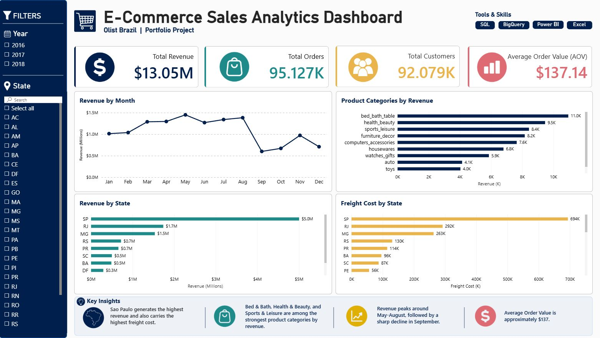

# Customer Churn & Retention Analysis

**SQL | Google BigQuery | Python | Pandas | Power BI**

## Project Overview

This project analyzes 7,043 telecom customer records to identify customer churn patterns, understand which customer segments are most likely to leave, and recommend potential retention strategies.

The analysis focuses on customer contracts, internet services, tenure, payment methods, and technical support.

## Business Questions

- What is the overall customer churn rate?
- Which contract types have the highest churn?
- Are fiber-optic customers more likely to churn?
- How does customer tenure relate to churn?
- Which customer segments should be prioritized for retention?

## Tools & Technologies

- **Python & Pandas:** Data cleaning, missing-value handling, and customer segmentation
- **Google BigQuery & SQL:** Customer analysis, aggregation, filtering, and churn-rate calculations
- **Power BI:** Interactive dashboards, KPI reporting, and customer churn visualization

## Key Findings

| Metric | Result |
|---|---|
| Total Customers | 7,043 |
| Churned Customers | 1,869 |
| Overall Churn Rate | 26.54% |
| Month-to-Month Contract Churn | 42.71% |
| One-Year Contract Churn | 11.27% |
| Two-Year Contract Churn | 2.83% |
| Month-to-Month Fiber-Optic Churn | Approximately 54.6% |

### Business Insights

**1. Contract Type:** Month-to-month customers have substantially higher churn rates than customers with longer contracts.

**2. Internet Service:** Fiber-optic customers on month-to-month contracts represent a particularly high-churn segment.

**3. Customer Retention:** Contract structure and internet service type are useful factors for identifying customer segments that may benefit from targeted retention efforts.

## Business Recommendations

1. Test incentives that encourage month-to-month customers to consider longer contracts.
2. Investigate fiber-optic customer satisfaction, service reliability, and pricing concerns.
3. Prioritize retention outreach for customer segments with elevated churn rates.
4. Monitor churn rates over time to evaluate the effectiveness of retention initiatives.

## Dashboard

## Project Files

- `telco_churn_cleaned.csv` — Cleaned customer dataset
- `Churn Analysis.sql.txt` — SQL queries used to analyze customer churn
- `1788477651946.jpeg` — Power BI dashboard screenshot

## Conclusion

The analysis identifies month-to-month contracts, particularly among fiber-optic customers, as an important area for retention investigation. These findings can help guide targeted customer outreach, further service-quality analysis, and potential contract incentive strategies.

*This is a portfolio project using a public IBM Telco Customer Churn sample dataset. Findings demonstrate associations rather than proven causes of churn.*
